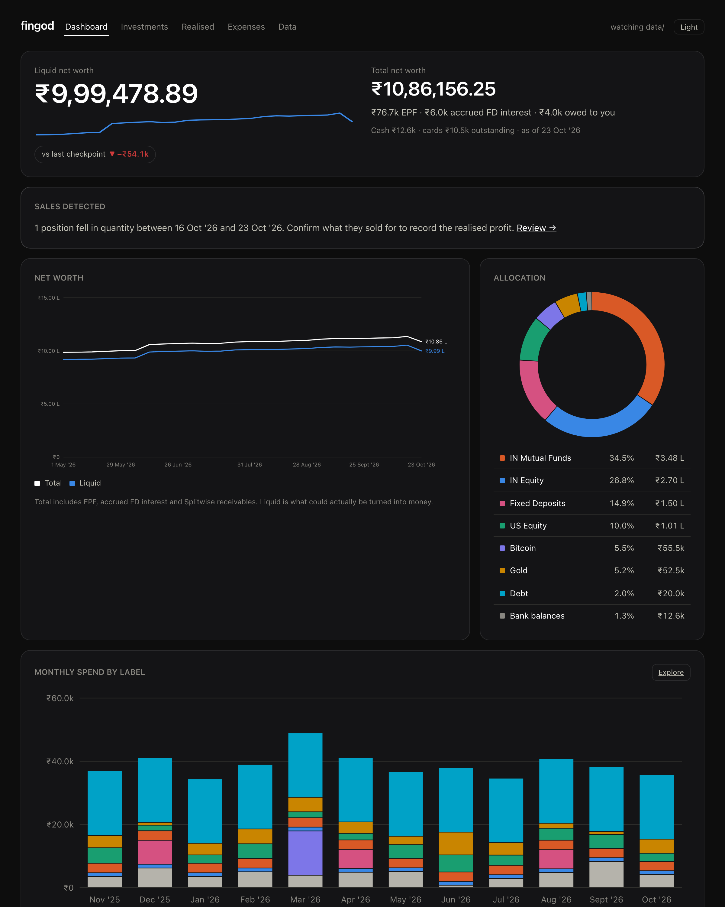
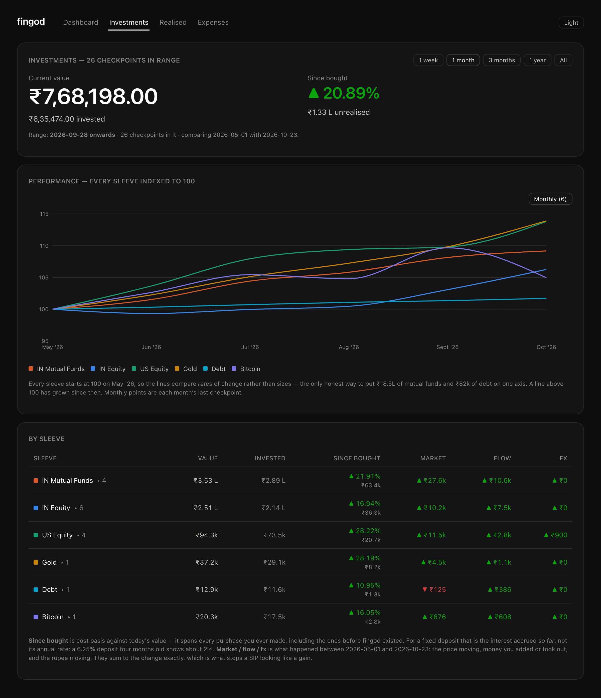

# fingod

**Your net worth, on your own machine.**

fingod connects Wallet, Zerodha, INDmoney and Bitcoin through your coding assistant, then shows what
actually grew and what you simply added. It runs entirely in your browser: vanilla JavaScript and
SQLite compiled to WebAssembly. **No backend, no database server, no build step, no account.**



<sub>Rendered from invented demo data. No real data appears anywhere in this repository.</sub>

## Set it up in one prompt

**1. Start your assistant inside the repo.** That is what lets it load the project's MCP servers, so there is
nothing to restart later. Each agent loads the project's MCP config its own way (`.mcp.json`, `.codex/config.toml`,
`.gemini/settings.json`; all shipped in the repo), and asks you to approve or trust it once.

```bash
# Claude Code
git clone https://github.com/HarishTeens/fingod.git && cd fingod && claude
# Codex CLI
git clone https://github.com/HarishTeens/fingod.git && cd fingod && codex
# Gemini CLI
git clone https://github.com/HarishTeens/fingod.git && cd fingod && gemini
```

**2. Paste this** into your agent: [Claude Code](https://claude.com/claude-code), Codex CLI, Gemini CLI, or any
coding assistant with shell access and MCP support:

```text
Set up fingod for me, a local-first net worth tracker that runs in my browser.

1. If this repo isn't already your working folder, clone https://github.com/HarishTeens/fingod and work from there.
2. Read docs/ONBOARDING.md and follow it step by step. It covers serving the app and opening it in my browser, finding out which accounts I use, connecting them, and writing my data into data/.
3. Run it in this terminal as a short form: use your multiple-choice question tool for every choice (selectable options, then a submit step), and plain questions only for numbers and text.

Rules: read-only. Never place, modify or cancel an order. Never commit anything from data/. Ask me before anything that depends on my preferences.
```

The same prompt lives in [PROMPT.md](PROMPT.md). Your agent follows [docs/ONBOARDING.md](docs/ONBOARDING.md): it serves the app, opens it in
your browser, asks which accounts you use, connects them and writes your data, all as a short form in your terminal: selectable options, then a submit step.
The browser just shows the result, and fills in on its own. (Pasting the prompt into a session that started somewhere
else also works: it clones the repo and tells you to restart inside the folder before it connects anything.)

## Or just look around

```bash
git clone https://github.com/HarishTeens/fingod.git
cd fingod
python3 serve.py        # → http://localhost:8000
```

Open it and choose **Explore with demo data**, or go to `http://localhost:8000/?demo`. There is nothing to
install: no npm, no bundler. You need Python 3 (only for its built-in static file server) and a
modern browser.

## Features

- **Net worth, two ways.** *Liquid* is what you could act on; *total* adds EPF, accrued FD interest and
  Splitwise receivables. Both are computed at every checkpoint.
- **Growth, split honestly.** Every change between checkpoints is separated into **market**, **flow**
  (money you added or withdrew) and **FX**. The three sum exactly to the change, so a ₹50k SIP never
  masquerades as ₹50k of market gain.
- **Performance across assets.** Indian equity, mutual funds, US equity, gold, debt, Bitcoin and fixed
  deposits on one axis indexed to 100, time-weighted so money you add or take out never distorts it.
- **Allocation against targets.** Set a target per asset and see the drift and what to buy or sell.
- **Realised profit.** Sales are detected by diffing checkpoints; you confirm the sale price and it is
  recorded, with win rate, holding period and gross wins versus gross losses.
- **Expenses you can drill into.** Weekly or monthly spend by label, down through category to the single
  transaction, net of money that came back.
- **Stays current.** Each checkpoint starts by fast-forwarding to the latest `main`, and your agent tells you what changed.
- **A 52-week price watch** on every refresh, for mega-cap US stocks and your gold ETF.
- **Local and read-only.** Your data lives in your browser and in a gitignored folder. Nothing is ever
  traded.



## How it works

```
Your coding agent
   ├─ Wallet MCP      → expense transactions, cash, credit cards
   ├─ Kite MCP        → Indian equity, Indian mutual funds
   ├─ INDmoney MCP    → US equity, EPF
   └─ asks you        → Bitcoin
        └──► writes JSON into data/  ──►  a local server lists it  ──►  the browser imports it into SQLite
```

Browsers can't speak MCP, and your broker credentials should never touch a web page. So **your assistant
does the connecting**, on your machine, and the only thing that crosses into the app is plain JSON in a
folder that git ignores.

A **checkpoint** is an immutable snapshot of every position on one date. Nothing polls. Growth is
derived by diffing consecutive checkpoints and watching **quantity**:

```
market =  qty_prev × (price_now − price_prev) × fx_now
flow   = (qty_now − qty_prev) × price_now × fx_now
fx     =  qty_prev × price_prev × (fx_now − fx_prev)
```

Those three terms sum to the change in value as an algebraic identity, not an approximation.

Each source owns exactly one set of assets, because overlapping sources disagree and reconciling them
only hides which one is wrong:

| Source | Owns |
|---|---|
| Wallet | expenses, cash, credit cards |
| Zerodha Kite | Indian equity, mutual funds, gold and liquid ETFs |
| INDmoney | US equity, EPF |
| Manual | Bitcoin, fixed deposits, Splitwise |

## Documentation

| Doc | What |
|---|---|
| [PROMPT.md](PROMPT.md) | The one-prompt setup |
| [docs/ONBOARDING.md](docs/ONBOARDING.md) | The terminal conversation your agent runs to set you up |
| [docs/DATA-FORMAT.md](docs/DATA-FORMAT.md) | The JSON files your agent writes |
| [docs/ARCHITECTURE.md](docs/ARCHITECTURE.md) | The qty-diff engine, sleeves, net worth, data model |
| [docs/MCP-SHAPES.md](docs/MCP-SHAPES.md) | What each MCP server returns and how it maps to a checkpoint |
| [CLAUDE.md](CLAUDE.md) | Guidance for coding agents working in this repo |
| [`.claude/skills/refresh`](.claude/skills/refresh/SKILL.md) | The `/refresh` routine |
| [`landing/`](landing/index.html) | The landing page |

## Privacy and security

- Your data stays on your machine: in your browser's SQLite database, and in `data/`, which is
  gitignored. There is no account, server, telemetry or analytics.
- Every connector is read-only. The refresh routine never calls `place_order`, `modify_order`,
  `cancel_order` or the GTT equivalents, and `.claude/settings.json` **denies those Kite tools
  outright**, so Claude Code refuses them even if an instruction asked for one. The same file
  pre-approves only the local server, `localhost` links and the tests.
- The local server binds to `127.0.0.1` only (`--bind 127.0.0.1`; `serve.py` does the same).
- The database lives in browser storage, so clearing site data erases it. **Data → Download backup**
  saves a `.sqlite` file you can restore anywhere.
- Never commit anything from `data/`, and never commit a screenshot of your own dashboard.

## Tests

```bash
node --test tests/      # 30 tests: the engine, plus ingest validation. Node 20+, no dependencies.
```

## License

Licensed under the [Apache License 2.0](LICENSE). Use it, change it and ship it as you like; the license
asks only that you keep the notice and say what you changed. It comes with no warranty, and nothing here
is financial advice. SQLite is compiled to WebAssembly by [sql.js](https://github.com/sql-js/sql.js)
(MIT), vendored in `vendor/`.
